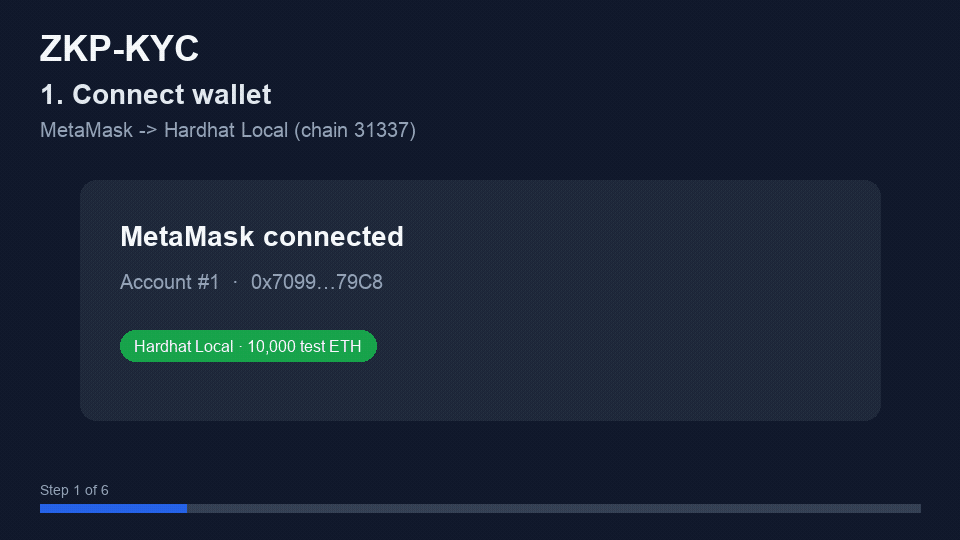
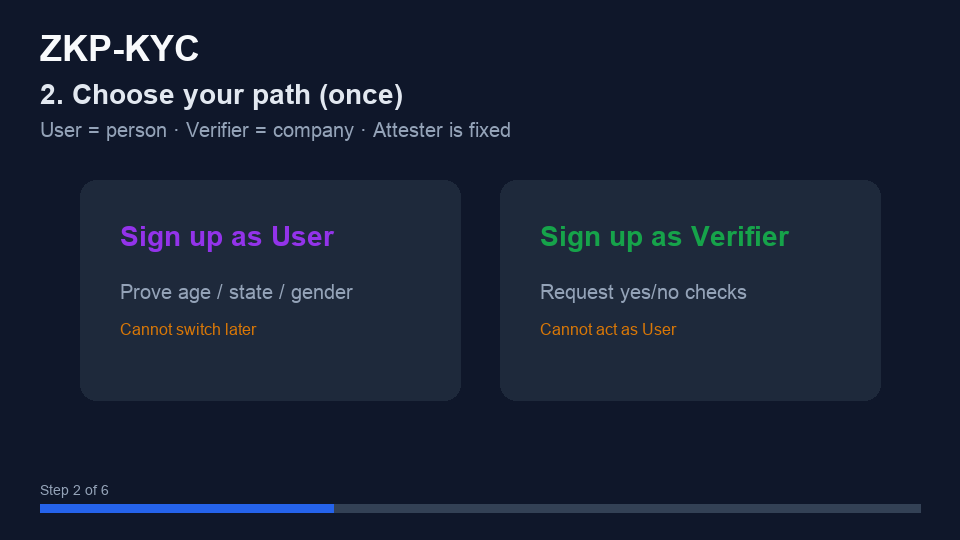
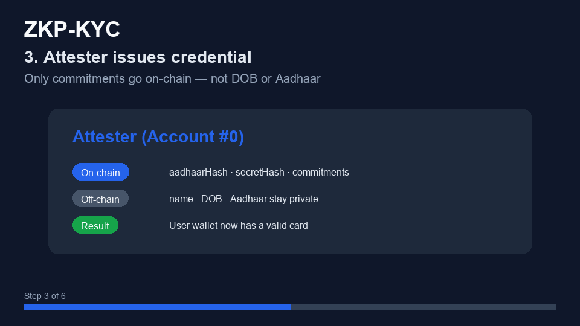
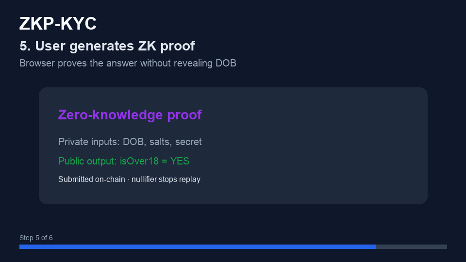

# ZKP-KYC

**Privacy-preserving KYC checks with zero-knowledge proofs.**

Prove *“I’m over 18”*, *“I live in state X”*, or *“my gender matches”* — without revealing date of birth, Aadhaar number, or other raw identity data to the company asking, and without putting that PII on the blockchain.



---

## Why this app exists

Companies need compliance answers. People need privacy. Classic KYC fails both sides:

- Users upload full IDs to every service → **data sprawl**
- Companies store databases of DOBs and ID numbers → **breach risk**
- “We checked offline” → **no cryptographic proof**

**ZKP-KYC** lets a trusted **Attester** issue cryptographic commitments, then lets a **User** generate a **zero-knowledge proof** that a **Verifier** (company) can check on-chain. The Verifier learns a **yes/no** — not the underlying personal fields.

### Who benefits

| Who | Benefit |
|-----|---------|
| **Users** | Share proofs, not documents; control when to answer |
| **Verifiers** | Cryptographically check attributes without holding PII |
| **Attesters** | Issue once; many companies can request checks later |
| **Builders / students** | Full stack: Circom → snarkjs → Solidity → Next.js |

---

## How it works (30 seconds)

<p align="center">
  
  
</p>
<p align="center">
  
  
</p>

1. **Connect** MetaMask to Hardhat Local  
2. **Sign up once** as **User** (person) or **Verifier** (company) — Attester is fixed at deploy  
3. **Attester** issues a credential (commitments only on-chain)  
4. **Verifier** requests a check (e.g. over 18)  
5. **User** proves in the browser — DOB never leaves the private witness  
6. **On-chain** Groth16 verify → Verifier sees **YES / NO**

Visitor shortcut (no roles): open **`/try`** and self-issue a mock ID.

---

## Features

- **Groth16 ZK proofs** for age, state of residence, and gender  
- **Role registry** — one Attester; User XOR Verifier (locked on-chain)  
- **Nullifiers** — stop proof replay  
- **Next.js portals** — Attester / Verifier / User + wallet connect & logout  
- **`/try` sandbox** — anyone can walk a one-wallet demo  
- **Hardhat local demo** — funded test accounts with 10,000 ETH each  

---

## Quick start (3 terminals)

**Prerequisites:** Node.js 16+, npm, MetaMask (browser).

```bash
cd zkp-kyc-system
npm install
cd frontend && npm install && cd ..
```

**Terminal 1 — chain**
```bash
npx hardhat node
```

**Terminal 2 — deploy**
```bash
npx hardhat run scripts/02-deploy-all-contracts.js --network localhost
# optional: pre-issue Alice / Bob / Charlie cards
npx hardhat run scripts/03-issue-aadhaar.js --network localhost
```

**Terminal 3 — UI**
```bash
cd frontend
npm run dev -- --port 3001
```

Open **http://127.0.0.1:3001**

### MetaMask

| Setting | Value |
|---------|--------|
| Network | Hardhat Local |
| RPC | `http://127.0.0.1:8545` |
| Chain ID | `31337` |
| Accounts | Import keys from [docs/HARDHAT_ACCOUNTS.md](docs/HARDHAT_ACCOUNTS.md) |

- **#0** → Attester (no signup)  
- **#3** → Sign up as **Verifier**  
- **#1** (etc.) → Sign up as **User**  
- Or go to **`/try`** with any funded account  

> Restarting `hardhat node` resets the chain — run deploy again.

---

## Demo walkthrough GIF


Same file: [`frontend/public/demo.gif`](frontend/public/demo.gif) · step stills in [`docs/demo-frames/`](docs/demo-frames/).

---

## Project layout

```
zkp-kyc-system/
├── circuits/          # Circom (Over18, State, Gender)
├── contracts/         # Attester, RoleRegistry, verifiers, Demo*
├── frontend/          # Next.js app (portals + /try)
├── scripts/           # Deploy, issue, demo scripts
├── test/              # Hardhat tests
└── docs/              # Architecture, threat model, try-it, accounts, demo.gif
```

You only need this folder to run the app — not `groth16-from-scratch`.

---

## Documentation

| Doc | What’s inside |
|-----|----------------|
| [docs/ARCHITECTURE.md](docs/ARCHITECTURE.md) | System design, why these choices, advantages, improvements |
| [docs/TRY_IT.md](docs/TRY_IT.md) | Visitor participation checklist |
| [docs/HARDHAT_ACCOUNTS.md](docs/HARDHAT_ACCOUNTS.md) | 10 labeled test wallets + private keys |
| [docs/THREAT_MODEL.md](docs/THREAT_MODEL.md) | What still leaks & how to harden |
| [docs/demo.gif](docs/demo.gif) | Animated how-it-works |

---

## Tests

```bash
npx hardhat test
# focused:
npx hardhat test test/RoleRegistry.test.js
npx hardhat test test/DemoVisitor.test.js
npx hardhat test test/Over18.test.js
```

---

## Tech stack

- **Circuits:** Circom 2, Poseidon, snarkjs Groth16  
- **Chain:** Solidity 0.8, Hardhat, OpenZeppelin Ownable, BN254 precompiles  
- **App:** Next.js, ethers v6, MetaMask  

---

## Design in one paragraph

Issuance puts **commitments** on-chain (not PII). Verification uses **Groth16** so Ethereum can check proofs cheaply. A **two-step request/complete** flow binds proofs to a company and request ID; **nullifiers** stop reuse. **Roles** keep issuers, companies, and people separate. That solves “prove a KYC fact without handing over the document” for demos and teaching — with a clear path to L2, Merkle roots, and soulbound passes for production scale. Details: [docs/ARCHITECTURE.md](docs/ARCHITECTURE.md).

---

## Sharing with someone else

Copy **`zkp-kyc-system`**, run `npm install` in root and `frontend`, then the three terminals above. They need MetaMask on the **same machine** as Hardhat (phone MetaMask usually cannot reach `127.0.0.1`).

---

## Disclaimer

Demo / educational software. Mock Government IDs only. Hardhat keys are public test keys — **never** use them on mainnet or send real funds. Not a regulated KYC product.

---

## License

See [LICENSE](LICENSE) if present in this repository.
