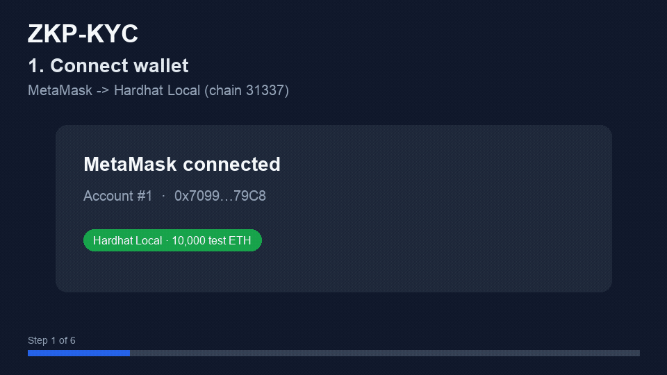

# Try it (for a visitor — not just the author)



This is **not** a one-person toy. Anyone with MetaMask can walk the demo on a laptop that has the repo + Hardhat running.

## What you can do

1. Open the app in a browser  
2. Connect **your** wallet (any Hardhat-funded account)  
3. Self-issue a **mock** Government ID (no Attester privilege)  
4. Prove “I’m over 18” without revealing DOB  
5. Claim a demo pass on-chain  

Advanced multi-role portals (Attester / Verifier / User) still exist for the original KYC story.

## Setup (host machine — once)

```bash
# Terminal A
cd zkp-kyc-system && npx hardhat node

# Terminal B
npx hardhat run scripts/02-deploy-all-contracts.js --network localhost
# (optional) issue sample Alice/Bob cards for the advanced portals:
npx hardhat run scripts/03-issue-aadhaar.js --network localhost

# Terminal C
cd frontend && npm run dev -- --port 3001
```

Open **http://127.0.0.1:3001/try**

## MetaMask (visitor)

1. Network: RPC `http://127.0.0.1:8545`, chain id `31337`, currency ETH  
2. Import Hardhat test keys from [HARDHAT_ACCOUNTS.md](HARDHAT_ACCOUNTS.md) — Attester (#0), Verifier (#3), plus 8 user accounts (#1–2, #4–9), each with 10,000 test ETH  
3. Click **Try the demo** on the home page  

You do **not** need to be Account #0. Use browser MetaMask on the same laptop as Hardhat (phone MetaMask usually cannot hit localhost).

## Checks

```bash
cd zkp-kyc-system && npx hardhat test test/DemoVisitor.test.js
```

## Honest limits

- Local chain only unless you deploy to Sepolia (human step; needs funded key)  
- Mock IDs are not real government credentials  
- Hosted public URL is optional later (Vercel + Sepolia) — the **participation** path is the `/try` wizard  
